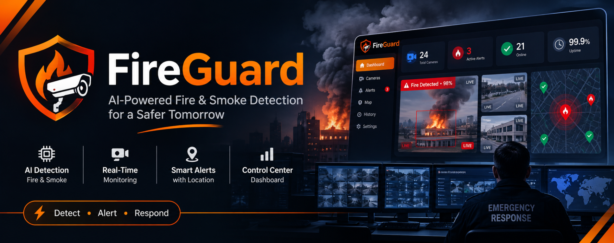

# Danger Detection



**AI-powered, real-time fire and smoke detection for any camera — with instant alerts to your phone.**

Danger Detection watches a webcam with YOLO computer vision, spots fire and smoke frame by frame, tracks people, and pushes alerts to an installable web dashboard on every phone or laptop on your network. Everything runs on your own machine: no cloud, no subscription, no video leaves your computer.


> [!IMPORTANT]
> Danger Detection adds awareness. It is **not** a certified fire alarm. Always keep tested smoke alarms installed and follow local fire-safety regulations.

---

## Contents

1. [What it does](#what-it-does)
2. [How it works](#how-it-works)
3. [Repository layout](#repository-layout)
4. [Requirements](#requirements)
5. [Quick start](#quick-start)
6. [Model weights](#model-weights)
7. [Running the system](#running-the-system)
8. [Using the desktop monitor](#using-the-desktop-monitor)
9. [Using the web dashboard](#using-the-web-dashboard)
10. [Configuration](#configuration)
11. [API reference](#api-reference)
12. [Detection details](#detection-details)
13. [Data and logging](#data-and-logging)
14. [Security](#security)
15. [Project website](#project-website)
16. [Development](#development)
17. [Troubleshooting](#troubleshooting)
18. [Roadmap](#roadmap)
19. [Contributing](#contributing)
20. [License and acknowledgments](#license-and-acknowledgments)

---

## What it does

| Capability | Details |
|---|---|
| **Fire detection** | A fine-tuned YOLO model finds flames and burning objects in each frame. |
| **Smoke detection** | The same model detects smoke, often before flames are visible. |
| **Person tracking** | Optional COCO model tracks people across frames and flags sustained fast (unusual) movement. |
| **Object detection** | The COCO model also labels general objects for context (up to 30 boxes per frame). |
| **Real-time alerts** | Fire and smoke counts are posted to a FastAPI server and broadcast over WebSocket to every connected browser. |
| **Web dashboard** | Installable PWA with live status, charts, event history, a side alert panel, sound, vibration and system notifications. |
| **Event logging** | Detections and session events are written to SQLite; the server keeps the latest 500 alerts in memory. |
| **Local-first** | Detection runs on your hardware. Only small JSON alert payloads travel over your network. |

---

## How it works

Three pieces work together. The desktop app owns the camera, the server fans alerts out, and any browser can listen.

```
┌──────────────────────────┐   HTTP POST          ┌──────────────────────────┐   WebSocket    ┌──────────────────────────┐
│  Desktop monitor         │   /internal/alert    │  Alert server            │   /ws          │  Web dashboard (PWA)     │
│  Tkinter + OpenCV + YOLO │ ───────────────────▶ │  FastAPI                 │ ─────────────▶ │  React + Vite            │
│                          │  {"fire":1,"smoke":0}│                          │                │                          │
│  • reads the camera      │                      │  • checks optional token │                │  • live status & charts  │
│  • detects fire / smoke  │                      │  • keeps last 500 alerts │ ◀───────────── │  • alert side panel      │
│  • tracks people         │                      │  • broadcasts to clients │  GET           │  • event history         │
│  • logs to SQLite        │                      │  • serves web/dist       │  /api/events   │  • installable           │
└──────────────────────────┘                      └──────────────────────────┘                └──────────────────────────┘
```

1. The **desktop monitor** captures frames on a worker thread and runs YOLO inference.
2. When fire or smoke is found, it posts the counts to the server (debounced to at most one alert every 0.45 s).
3. The **alert server** records the alert and pushes it to every WebSocket client within ~50 ms.
4. The **web dashboard** shows the alert in its side panel, plays a tone, vibrates and (optionally) raises a system notification. It also polls `/api/events` every 12 s for history.

The desktop app and server are separate processes, so the server can run on the same computer or anywhere on your network.

---

## Repository layout

```
Danger-Detection/
├── danger_detection/            # Python application (active)
│   ├── app/
│   │   ├── main.py              # Desktop monitor (Tkinter UI)
│   │   ├── ui.py                # Desktop theme and custom widgets
│   │   ├── detector.py          # YOLO engine, person tracker, class mapping
│   │   ├── alert_notify.py      # Posts alerts to the server
│   │   ├── pwa_server.py        # FastAPI server: REST, WebSocket, static PWA
│   │   ├── alert_log.py         # In-memory alert history (last 500)
│   │   ├── sqlite_store.py      # Background SQLite writer
│   │   └── utils.py             # Model / database path resolution, frame helpers
│   ├── models/                  # YOLO weights (not in Git — download them)
│   ├── data/                    # SQLite database and snapshots (created at runtime)
│   └── requirements.txt
├── web/                         # Web dashboard (React + Vite PWA) → see web/README.md
├── landing-page/                # Project website and documentation → see landing-page/README.md
├── app/                         # Legacy desktop prototype (reference only) → see app/README.md
├── docs/assets/                 # Images used in this README
├── run-desktop.sh               # Starts the desktop monitor with the project venv
├── run-pwa-server.sh            # Starts the alert server on 127.0.0.1:8000
├── vercel.json                  # Deploys landing-page/ to Vercel
└── LICENSE
```

---

## Requirements

| Requirement | Version | Used for |
|---|---|---|
| Python | 3.10 or newer, **with Tk** | Desktop monitor, detection engine, alert server |
| Node.js | 18 or newer (22.12+ for `landing-page/`) | Building the web dashboard and website |
| Webcam | Any OpenCV-compatible camera | Video input (camera `0` by default) |
| Fire/smoke weights | `fire_smoke.pt` | Fire and smoke detection |
| COCO weights (optional) | `yolov8n.pt` | Person tracking and general objects |

Python packages (`danger_detection/requirements.txt`): `opencv-python`, `ultralytics`, `pillow`, `fastapi`, `uvicorn[standard]`.

> [!NOTE]
> Tk ships with the python.org installers. With Homebrew Python on macOS, install the matching formula, for example `brew install python-tk@3.12`. On Debian/Ubuntu use `sudo apt install python3-tk`.

A CUDA-capable GPU is optional; Ultralytics runs on the CPU and uses a GPU automatically when PyTorch can see one.

---

## Quick start

```bash
# 1. Clone
git clone https://github.com/Miftah-Fentaw/Danger-Detection.git
cd Danger-Detection

# 2. Python environment
python3 -m venv venv
source venv/bin/activate            # Windows: venv\Scripts\activate
pip install --upgrade pip
pip install -r danger_detection/requirements.txt

# 3. Model weights (see "Model weights" for details)
mkdir -p danger_detection/models
#   → save the fire/smoke checkpoint as danger_detection/models/fire_smoke.pt

# 4. Build the web dashboard
cd web && npm install && npm run build && cd ..

# 5. Run (two terminals)
./run-pwa-server.sh                 # terminal 1: alert server + dashboard on :8000
./run-desktop.sh                    # terminal 2: desktop monitor
```

Open **http://localhost:8000** for the dashboard, then press **Start monitoring** (or <kbd>Space</kbd>) in the desktop window.

---

## Model weights

Danger Detection uses Ultralytics YOLO object-detection checkpoints. Model files are large, so they are ignored by Git and must be downloaded into every fresh clone.

### Fire and smoke model (required)

Download `yolov8n.pt` from the [SHOU-ISD/fire-and-smoke](https://huggingface.co/SHOU-ISD/fire-and-smoke) model page (**Files and versions** tab) and save it as:

```text
danger_detection/models/fire_smoke.pt
```

Or download it with the Hugging Face client:

```bash
pip install huggingface_hub
python - <<'PY'
from pathlib import Path
from huggingface_hub import hf_hub_download

source = hf_hub_download(repo_id="SHOU-ISD/fire-and-smoke", filename="yolov8n.pt")
target = Path("danger_detection/models/fire_smoke.pt")
target.parent.mkdir(parents=True, exist_ok=True)
target.write_bytes(Path(source).read_bytes())
print(f"Saved {target}")
PY
```

Verify the classes:

```bash
python -c "from ultralytics import YOLO; print(YOLO('danger_detection/models/fire_smoke.pt').names)"
```

The output should include `Fire` and `Smoke`.

> [!WARNING]
> The standard COCO `yolov8n.pt` has **no** fire or smoke classes. Using it as the fire/smoke model will never detect a hazard.

### Person and object model (optional)

Person tracking and general object labels use COCO YOLOv8n weights at `danger_detection/models/yolov8n.pt`. They are only loaded if the file exists; without it, fire and smoke detection still work but the People and Objects counters stay at zero. To get the file:

```bash
python -c "from ultralytics import YOLO; print(YOLO('yolov8n.pt').ckpt_path)"   # downloads and prints where it was saved
mv <printed path> danger_detection/models/yolov8n.pt
```

### Search order and custom models

The fire/smoke model is chosen in this order:

1. `DANGER_DETECTION_MODEL` (absolute path, or relative to the current directory)
2. `app/models/fire_smoke.pt`
3. `danger_detection/models/fire_smoke.pt`
4. `app/models/yolov8n.pt`, or the first `*.pt` file in `app/models/`
5. `danger_detection/models/yolov8n.pt`

Any Ultralytics checkpoint works as long as its class names contain `fire`, `flame`, `burning`, `smoke` or `smoking` (case-insensitive):

```bash
export DANGER_DETECTION_MODEL=/absolute/path/to/my_model.pt
./run-desktop.sh
```

---

## Running the system

### Production-style (recommended)

Build `web/` once, then run two processes:

| Terminal | Command | What it does |
|---|---|---|
| 1 | `./run-pwa-server.sh` | FastAPI on `127.0.0.1:8000`, serves `web/dist` |
| 2 | `./run-desktop.sh` | Desktop monitor with the camera |

Open **http://localhost:8000** and check the server:

```bash
curl http://127.0.0.1:8000/health      # → {"status":"ok"}
```

### Web dashboard development

Run the Vite dev server as a third process for hot reload:

```bash
cd web && npm run dev                  # http://localhost:5173, talks to :8000
```

### Manual commands (without the scripts)

```bash
source venv/bin/activate
export PYTHONPATH="${PWD}"
uvicorn danger_detection.app.pwa_server:app --host 127.0.0.1 --port 8000
python -m danger_detection.app.main
```

The helper scripts do the same but expect the virtual environment at `./venv`.

### Desktop monitor only

The desktop monitor works on its own. If the server is not running, alerts that cannot be delivered are dropped silently and the hazard is still shown locally.

### Other devices on your network

Start the server on all interfaces and open it from a phone using the computer's LAN address:

```bash
./run-pwa-server.sh --host 0.0.0.0     # extra flags are passed to uvicorn
# then visit http://<computer-ip>:8000 on your phone
```

Set `DANGER_DETECTION_ALERT_TOKEN` when the server is reachable by other machines (see [Security](#security)).

---

## Using the desktop monitor

```
┌──────────────────────────────────────────────────────────────────────────────┐
│ ▲ DANGER DETECTION                                     ● LIVE      14:02:11  │
├───────────────────────────────────────────────────┬──────────────────────────┤
│ ● CAMERA 0  [Live]             1280×720 · 24 fps ⤢│ ACTIONS                  │
│ ┌───────────────────────────────────────────────┐ │ [■ Stop monitoring     ] │
│ │ ▲ FIRE DETECTED   Alert forwarded to web app  │ │ [◉ Snapshot][↗ Web app ] │
│ │                                               │ │ [!  Send test alert    ] │
│ │                 live camera feed              │ │ LIVE DETECTIONS          │
│ │                                               │ │ Fire 1  Smoke 0          │
│ └───────────────────────────────────────────────┘ │ People 2  Objects 5      │
│ ■ Fire 1  ■ Smoke 0  ■ People 2  ■ Objects 5      │ SETTINGS · WEB APP · LOG │
└───────────────────────────────────────────────────┴──────────────────────────┘
```

| Area | What it shows |
|---|---|
| **Header** | Status pill (Standby, Starting, Live, Hazard, Error) and a clock. |
| **Camera panel** | REC indicator, camera number, resolution and FPS; the live feed fills the panel (switch **Fill / Fit** to see the whole frame). A flashing banner appears over the video while fire or smoke is in view. Chips below list the current fire, smoke, people and object counts plus an *Unusual movement* warning. |
| **Actions** | Start / Stop monitoring, **Snapshot** (saves the annotated frame to `danger_detection/data/snapshots/`), **Web dashboard** (opens the server in your browser) and **Send test alert** (posts `fire ×1` to the server). |
| **Live detections** | Counters for the current frame, plus session time, FPS, frames processed and alerts sent. |
| **Settings** | Camera number (locked while running), confidence threshold (applies instantly), **Forward alerts** on/off, and **Alert sound**. |
| **Web app** | Server address and whether `/health` answers (checked every 10 s). |
| **Activity** | Timestamped log of starts, stops, hazards, unusual movement, snapshots, errors and server changes. |

**Keyboard shortcuts:** <kbd>Space</kbd> start/stop · <kbd>S</kbd> snapshot · <kbd>F11</kbd> full screen · <kbd>Esc</kbd> leave full screen · <kbd>Ctrl</kbd>+<kbd>Q</kbd> (<kbd>⌘</kbd>+<kbd>Q</kbd> on macOS) quit.

If startup fails, the camera panel explains why (missing model, camera unavailable) and offers **Try again**.

---

## Using the web dashboard

The dashboard is a Progressive Web App served by the alert server at `http://localhost:8000`. Install it from the browser menu (**Install app** / **Add to Home Screen**) for one-tap access. Full details are in [web/README.md](web/README.md).

| Screen | Contents |
|---|---|
| **Overview** | Live status panel (All clear / Hazard detected / alerts needing attention / Monitoring paused) with the detector → server → device pipeline; KPI tiles for alerts, fire and smoke detections and last hazard, each with a trend and change vs. the previous period; a *Detections over time* chart; a fire-vs-smoke mix bar; recent events; and a system health card (connection uptime, server latency, last detector report). |
| **Events** | Full history for the selected range with search, Fire/Smoke filters, sorting and **Clear history** (asks for confirmation inline). |
| **Settings** | Sound, vibration, auto-open alert panel, system notifications, **Preview an alert**, theme (System / Light / Dark) and connection details. |
| **Alert panel** | New hazards slide into a side panel (it does not block the page). Acknowledge one or all, remove them, and see unread counts on the bell, the tab title and a floating button. |

The time range (1H, 24H, 7D, 30D) at the top scopes every chart and table. The live connection reconnects automatically if the server restarts.

---

## Configuration

### Python (desktop monitor and server)

| Variable | Default | Used by | Description |
|---|---|---|---|
| `DANGER_DETECTION_MODEL` | auto | detector | Path to fire/smoke weights; overrides the search order. |
| `DANGER_DETECTION_ALERT_URL` | `http://127.0.0.1:8000/internal/alert` | desktop | Where alerts are posted. Empty, `0`, `false`, `off` or `no` disables forwarding. |
| `DANGER_DETECTION_ALERT_TOKEN` | unset | both | Shared secret. When set on the server, requests without a matching `X-Alert-Token` header get HTTP 403. |
| `DANGER_DETECTION_DB_PATH` | `danger_detection/data/danger_detection.db` | detector | SQLite database location. |
| `DANGER_DETECTION_SQLITE` | `1` | detector | Enable (`1`) or disable (`0`) SQLite logging. |
| `DANGER_DETECTION_LOG_OBJECTS` | `1` | detector | Log every detected object to the `object_detections` table. |
| `DANGER_DETECTION_LOG_OBJECTS_EVERY_N_FRAMES` | `1` | detector | Only log objects every N frames (reduces database size). |
| `DANGER_DETECTION_PWA_AUTO_START` | `0` | server | Let the server open the camera itself instead of the desktop app. |
| `DANGER_DETECTION_NO_PWA_TIP` | unset | desktop | Set to `1` to hide the startup tip printed to the terminal. |

Example:

```bash
export DANGER_DETECTION_ALERT_TOKEN="change-me"
export DANGER_DETECTION_LOG_OBJECTS_EVERY_N_FRAMES=10
./run-pwa-server.sh      # terminal 1
./run-desktop.sh         # terminal 2 (same token exported)
```

### Web dashboard (Vite)

Only needed when the API is not at the default address during development. Copy `web/.env.example` to `web/.env.local`:

| Variable | Default | Description |
|---|---|---|
| `VITE_API_BASE` | same origin (prod), `http://<host>:8000` (dev) | REST base URL |
| `VITE_WS_URL` | same origin `/ws` (prod), `ws://<host>:8000/ws` (dev) | WebSocket URL |

---

## API reference

| Method | Path | Description |
|---|---|---|
| `GET` | `/` | Serves the built dashboard from `web/dist`, or a setup page if it has not been built. |
| `GET` | `/health` | Health check → `{"status": "ok"}` |
| `GET` | `/api/events?limit=50` | Recent alerts, newest first (`limit` 1–200). |
| `DELETE` | `/api/events` | Clear the in-memory history. |
| `POST` | `/api/events/clear` | Same as above, for clients that cannot send `DELETE`. |
| `POST` | `/internal/alert` | Ingest an alert from the desktop monitor. |
| `WS` | `/ws` | Live alert stream (receive-only). |

**`POST /internal/alert`**

```json
{ "fire": 1, "smoke": 0 }
```

Returns `{"ok": true}`, or `{"ok": false, "reason": "no hazard counts"}` when both counts are zero.

**`GET /api/events`**

```json
{
  "events": [
    {
      "ts": 1731000000.12,
      "iso": "2026-11-07T14:00:00.120000Z",
      "fire": 1,
      "smoke": 0,
      "source": "desktop_app",
      "summary": "fire ×1"
    }
  ]
}
```

**WebSocket `/ws`** — on connect the server sends `{"type": "hello", ...}`, then one message per alert:

```json
{ "type": "alert", "fire": 1, "smoke": 2, "ts": 1731000000.12, "source": "desktop_app" }
```

Try it without a camera:

```bash
curl -X POST http://127.0.0.1:8000/internal/alert \
  -H "Content-Type: application/json" \
  -d '{"fire": 1, "smoke": 0}'
```

Interactive API docs are available at `http://127.0.0.1:8000/docs` (generated by FastAPI).

---

## Detection details

### Pipeline

`FireSmokeDetector` reads frames with OpenCV, runs inference on a worker thread, draws overlays and hands the newest annotated frame to the UI through a single-slot queue (the preview always shows the latest frame, never a backlog).

### Confidence threshold

Boxes below **0.35** confidence are ignored by default. Change it live with the slider in the desktop monitor. Lower values catch more hazards but raise false positives.

### Class mapping

| Model label contains | Treated as |
|---|---|
| `fire`, `flame`, `burning` | fire |
| `smoke`, `smoking` | smoke |
| `fire hydrant` (COCO) | ignored |

### Person tracking

People (COCO class 0) are matched between frames by box overlap (IoU ≥ 0.25) or, failing that, by centre distance (≤ 150 px).

| Rule | Value |
|---|---|
| Movement counted as fast | more than 50 px between frames |
| Jump ignored (likely a mismatch) | more than 300 px |
| Fast frames in a row to flag *unusual movement* | 3 |

Flagged people are drawn in red. Person tracking is shown locally and logged; it does **not** send web alerts.

### Overlay colours

Fire: orange-red · Smoke: grey · Person: green (red when unusual) · Other objects: light cyan.

---

## Data and logging

| Store | Location | Contents | Lifetime |
|---|---|---|---|
| SQLite `object_detections` | `danger_detection/data/danger_detection.db` | Session, frame index, model, class, confidence, bounding box | Persistent |
| SQLite `app_flow_events` | same database | Session events (start, stop, errors) with JSON metadata | Persistent |
| Server alert log | memory | Last 500 alerts (what the dashboard shows) | Until the server restarts or history is cleared |
| Snapshots | `danger_detection/data/snapshots/` | PNG frames saved from the desktop monitor | Persistent |

Inspect the database with any SQLite client:

```bash
sqlite3 danger_detection/data/danger_detection.db \
  "SELECT created_at, class_name, ROUND(confidence, 2) FROM object_detections ORDER BY id DESC LIMIT 10;"
```

---

## Security

- The server binds to `127.0.0.1` by default, so only the local machine can reach it.
- If you expose it on your network (`--host 0.0.0.0`), set the **same** `DANGER_DETECTION_ALERT_TOKEN` for both processes so other devices cannot post fake alerts.
- `/api/events` and `/ws` are readable by anyone who can reach the server. Keep it on a trusted network or put it behind a reverse proxy with authentication.
- Clearing history from the dashboard clears it for every viewer.

---

## Project website

[`landing-page/`](landing-page/) contains the project's website and full documentation (React + Vite): features, how it works, installation guide, configuration, API reference and FAQ, with light and dark themes.

```bash
cd landing-page
npm install
npm run dev        # http://localhost:5173
```

The repository root includes `vercel.json`, so importing the repository into [Vercel](https://vercel.com/new) deploys the site with no extra settings. See [landing-page/README.md](landing-page/README.md).

---

## Development

| Package | Location | Commands |
|---|---|---|
| Python app | `danger_detection/` | `python -m danger_detection.app.main`, `uvicorn danger_detection.app.pwa_server:app --reload` |
| Web dashboard | `web/` | `npm run dev`, `npm run build`, `npm run lint`, `npm run preview` |
| Website | `landing-page/` | `npm run dev`, `npm run build`, `npm run lint`, `npm run preview` |

Tips:

- Use `uvicorn ... --reload` while editing `pwa_server.py`.
- Send fake alerts with the `curl` command above or **Settings → Preview an alert** in the dashboard (preview alerts stay in the browser).
- Keep model files out of Git; they are listed in `.gitignore`.

---

## Troubleshooting

<details>
<summary><strong>The camera does not open</strong></summary>

- Make sure the webcam is connected and not in use by another app (video calls, other monitors).
- Try another camera number in **Settings → Camera** (stop monitoring first).
- On macOS, allow camera access for your terminal or IDE in **System Settings → Privacy & Security → Camera**.

</details>

<details>
<summary><strong>"Model not found"</strong></summary>

Place the fire/smoke weights at `danger_detection/models/fire_smoke.pt`, or point `DANGER_DETECTION_MODEL` at them. See [Model weights](#model-weights).

</details>

<details>
<summary><strong>Fire or smoke is never detected</strong></summary>

- Check that the model's classes include fire and smoke (see the verification command in [Model weights](#model-weights)). The COCO `yolov8n.pt` will not work.
- Lower the confidence threshold in the desktop monitor.
- Improve lighting and make sure the hazard is clearly in frame.

</details>

<details>
<summary><strong>People and Objects always show 0</strong></summary>

The optional COCO model is missing. Save `yolov8n.pt` to `danger_detection/models/yolov8n.pt`.

</details>

<details>
<summary><strong>The dashboard says it is offline or reconnecting</strong></summary>

- Start the server with `./run-pwa-server.sh` and check `curl http://127.0.0.1:8000/health`.
- When using `npm run dev`, the server must be on port 8000 (or set `VITE_API_BASE` / `VITE_WS_URL`).

</details>

<details>
<summary><strong>Alerts never reach the dashboard</strong></summary>

- The desktop monitor's **Web app** card should say *Online*.
- **Settings → Forward alerts** must be on.
- `DANGER_DETECTION_ALERT_URL` must point at the server, and the alert token (if any) must match on both processes.

</details>

<details>
<summary><strong><code>ModuleNotFoundError: No module named '_tkinter'</code></strong></summary>

Your Python build has no Tk. Install `python-tk@<version>` (Homebrew) or `python3-tk` (Debian/Ubuntu), or use the python.org installer, then recreate the virtual environment.

</details>

<details>
<summary><strong>The scripts fail with "venv/bin/python: No such file or directory"</strong></summary>

`run-desktop.sh` and `run-pwa-server.sh` expect the virtual environment at `./venv`. Create it as shown in [Quick start](#quick-start), or run the manual commands instead.

</details>

<details>
<summary><strong>GitHub rejects the push because of large files</strong></summary>

Keep weights out of Git (they are in `.gitignore`). If one was committed, remove it from history:

```bash
git filter-repo --path path/to/large/file --invert-paths --force
```

</details>

---

## Roadmap

The detector already defines interfaces for two upcoming features:

- **Weapon detection** (`WeaponDetector`) — needs dedicated weights and a class map.
- **Abnormal behaviour analysis** (`AbnormalBehaviorDetector`) — unusual-activity detection beyond movement speed.

Ideas and pull requests are welcome in [GitHub issues](https://github.com/Miftah-Fentaw/Danger-Detection/issues).

---

## Contributing

1. Fork the repository and create a branch.
2. Make your change; run `npm run lint` and `npm run build` in any web package you touched.
3. Open a pull request describing what changed and how you tested it.

Bug reports with steps to reproduce, your OS, Python version and camera model are just as valuable.

---

## License and acknowledgments

Released under the [MIT License](LICENSE).

Built with:

- [Ultralytics YOLO](https://github.com/ultralytics/ultralytics) — object detection
- [SHOU-ISD/fire-and-smoke](https://huggingface.co/SHOU-ISD/fire-and-smoke) — fire and smoke checkpoint
- [OpenCV](https://opencv.org) — camera capture and drawing
- [FastAPI](https://fastapi.tiangolo.com) — alert server
- [React](https://react.dev) and [Vite](https://vite.dev) — web dashboard and website
- [vite-plugin-pwa](https://github.com/vite-pwa/vite-plugin-pwa) — installable PWA support
